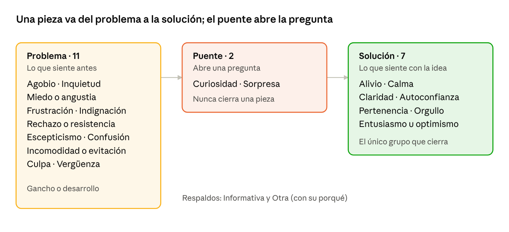

# Emociones para clasificar ideas en Conidolly

Nov 1, 2026 · @ring

## Para qué sirve esta lista

Conidolly saca ideas del material que estudias y con ellas arma piezas para LinkedIn e Instagram. A cada idea le pone etiquetas: qué tipo de idea es, qué evidencia la respalda, a qué público le habla, qué dolor toca y **qué emoción provoca en quien la lee**. Este documento trata solo de esa última etiqueta.

La emoción sirve para tres cosas:

1.  **Filtrar y buscar.** Por ejemplo, «ideas que dan alivio sobre síndrome del impostor» o «ideas que despiertan escepticismo sobre la IA en las organizaciones».

2.  **Armar piezas con arco.** Un buen contenido parte en un problema que la persona reconoce y termina en una salida. Sabiendo la emoción de cada idea, el motor y el Taller pueden proponerte el gancho, el desarrollo y el cierre con sentido.

3.  **Aprender qué funciona.** Con las métricas de cada red (cambio 13) se puede ver qué emociones generan más guardados, compartidos o conversaciones.

La lista la definiste tú el 1 de noviembre de 2026, a partir de una propuesta que revisó un comité de tres miradas: neuromarketing y copywriting, psicología de las emociones y ética, y estrategia por red y clasificación automática. Queda escrita en el cambio 6 del «Pedido de cambios», con su instrucción y su código.

**Cómo leer este documento.** Primero vienen los principios que sostienen la lista, después los tres grupos y las 20 emociones una por una. Siguen los criterios para no confundir emociones parecidas, las parejas para armar una pieza, las reglas éticas y, al final, cómo lo usa la app y qué quedó fuera.

## Los principios detrás de la lista

El punto de partida fue el neuromarketing, pero el comité recomendó apoyar la lista sobre todo en la ciencia afectiva, que tiene evidencia más firme y es más defendible para una psicóloga. Estos son los seis principios que la sostienen:

1.  **Valencia y activación.** Toda emoción se puede ubicar en dos ejes: si se siente agradable o desagradable (valencia) y cuánta energía moviliza (activación). Es el modelo circunflejo de Russell (1980). Por eso cada emoción de la lista trae fija su activación: alta, media o baja.

2.  **Lo intenso se comparte.** Berger y Milkman (2012) estudiaron qué artículos se compartían más y encontraron que los que despiertan emociones de activación alta (asombro, enojo, ansiedad) circulan más que los de activación baja, como la tristeza. Las emociones de activación baja o media sirven más para que alguien guarde, se identifique o vuelva.

3.  **Tensión y resolución.** La atención se engancha con un problema que la persona reconoce, y el recuerdo se arma sobre todo con el momento más intenso y con el final (regla del pico y el final, Kahneman y colegas, 1993). Por eso las emociones se ordenan en grupos de problema y de solución, y ninguna pieza termina en un problema.

4.  **Aversión a la pérdida.** Duele más perder que ganar lo mismo (Kahneman y Tversky, 1979). Es el motor de la inquietud y del miedo, y también la razón para usarlos con cuidado.

5.  **Brecha de curiosidad.** Una pregunta abierta pide cerrarse (Loewenstein, 1994). La curiosidad abre una tensión, pero no la resuelve. Por eso queda en un grupo propio, el puente.

6.  **Emociones autoconscientes.** La culpa, la vergüenza y el orgullo nacen de cómo una se evalúa a sí misma (Tangney y Dearing, 2002; Tracy y Robins, 2004). La culpa apunta a lo que hice; la vergüenza, a quién soy. La vergüenza es el núcleo de la sensación de impostora (Clance e Imes, 1978), y el orgullo por un logro propio es su antídoto.

A esto se suman dos ideas para las salidas: la autoeficacia, sentirse capaz de dar un paso concreto (Bandura, 1977), y la pertenencia como necesidad básica (Baumeister y Leary, 1995). Y una advertencia: los mensajes que usan el miedo solo funcionan si la persona siente que puede hacer algo; si no, se defiende y rechaza el mensaje (Witte, 1992).

## Los tres grupos

Cada emoción pertenece a uno de tres grupos, y ese grupo viene fijo con la emoción: Claude solo elige la emoción y la app sabe a qué grupo pertenece. Así no puede contradecirse.

Los tres grupos de emociones · 20 emociones y 2 respaldos

- **Problema (11 emociones).** Lo que la persona siente antes: el dolor que reconoce. Sirve para el gancho y el desarrollo, para nombrar lo que le pasa. Nunca para cerrar.

- **Puente (2 emociones).** Curiosidad y sorpresa. No resuelven nada: abren una pregunta o rompen una creencia. Son ideales para enganchar, pero una pieza que termina en curiosidad es un cebo de clics.

- **Solución (7 emociones).** Lo que la persona siente con la idea: alivio, calma, claridad, capacidad, compañía, orgullo o ganas. Es el único grupo con el que una pieza puede cerrar.

Hay dos respaldos que no son emociones: **Informativa**, para un dato sin reacción buscada, y **Otra**, cuando nada calza, que siempre trae una línea de por qué para que puedas revisarla.

El humor no está en la lista porque no es una emoción sino un tono. Queda para una etiqueta aparte (serio, cálido o con humor).

## Las 20 emociones en detalle

La columna «Red fuerte» dice dónde rinde más cada emoción. Es una orientación, no una restricción: cualquier emoción puede aparecer en cualquier red. Los ejemplos son frases en tu tono para mostrar qué tipo de idea provoca cada emoción.

### Problema: lo que la persona siente antes

| Emoción | Activación | Red fuerte | Qué es | Ejemplo |
|----|----|----|----|----|
| Agobio | Alta | Ambas | Demasiado, ahora: sobrecarga, no doy abasto. | «Abres el correo y ya tienes tres herramientas nuevas que “deberías” aprender esta semana.» |
| Inquietud | Media | Ambas | Preocupación por lo que podría pasar (mi rol, quedarme atrás). Se puede pensar y nombrar. | «La pregunta que nadie dice en voz alta en la reunión: ¿y mi rol, en qué queda?» |
| Miedo o angustia | Alta | Ambas | Una amenaza que se siente intensa o cercana, en el cuerpo: me paraliza, me quita el sueño. | «Hay líderes que no duermen bien desde que anunciaron la automatización de su área.» |
| Frustración | Alta | Ambas | La falla está afuera: hicimos todo y no resultó. | «Hicieron la capacitación, compraron las licencias, y nadie la usa. El problema no era la herramienta.» |
| Indignación | Alta | LinkedIn | Es injusto para un grupo. Apunta a sistemas y prácticas, nunca a personas. | «Cuando un algoritmo aprende de decisiones sesgadas, el sesgo no desaparece: se escala.» |
| Rechazo o resistencia | Alta | LinkedIn | No lo quiero y me opongo, aunque funcione: defensa activa de una forma de trabajar. | «“Aquí siempre lo hemos hecho así y nos ha ido bien.” Esa frase frena más proyectos de IA que cualquier presupuesto.» |
| Escepticismo | Media | LinkedIn | No me lo creo, me venden humo: duda sobre si es cierto. | «Si te huele a humo cada vez que alguien dice “la IA lo cambia todo”, no estás tan perdido.» |
| Confusión | Media | Ambas | No entiendo, información contradictoria, no sé por dónde partir. | «Un día la IA te reemplaza, al otro es una moda. Con razón no sabes por dónde partir.» |
| Incomodidad o evitación | Baja | Ambas | Prefiero no mirarlo: lo esquivo, lo postergo, después lo veo. | «Esa pestaña de “aprender IA” que llevas tres meses sin abrir.» |
| Culpa | Media | Instagram | Hice o no hice algo que creía que debía. Apunta a una conducta. | «Otra semana sin hacer la pausa que te prometiste.» |
| Vergüenza | Baja | Instagram | Soy insuficiente o un fraude, y temo que lo noten. Apunta al yo. Es el núcleo de la sensación de impostora. | «Esa voz que te dice que tarde o temprano se van a dar cuenta de que no sabes tanto.» |

### Puente: abre una pregunta

| Emoción | Activación | Red fuerte | Qué es | Ejemplo |
|----|----|----|----|----|
| Curiosidad | Alta | Ambas | La pregunta queda abierta: hay algo que quiero saber. | «Hay una razón por la que tus equipos más expertos son los que más se resisten. No es la que crees.» |
| Sorpresa | Alta | Ambas | El dato ya rompió la creencia: algo que creía no es así. | «La resistencia a la IA no es falta de habilidad. Muchas veces es lealtad a una forma de hacer bien el trabajo.» |

### Solución: lo que la persona siente con la idea

| Emoción | Activación | Red fuerte | Qué es | Ejemplo |
|----|----|----|----|----|
| Alivio | Media | Instagram | Baja la carga: tiene nombre, explicación o permiso. | «Eso que sientes tiene nombre, y no habla de tu capacidad: habla de cuánto te importa hacerlo bien.» |
| Calma | Baja | Instagram | Paz, margen, bajar el ritmo. Es un estado, no una transición. | «Hoy no tienes que aprender todo. Basta con respirar y elegir una sola cosa.» |
| Claridad | Media | LinkedIn | Ahora entiendo cómo decidir: un marco o criterio que ordena. | «Antes de elegir una herramienta, hazte tres preguntas. Con eso ya sabes si adoptar, esperar o descartar.» |
| Autoconfianza | Media | Ambas | Sí puedo: tengo un paso concreto y me siento capaz. | «Esta semana, elige una sola tarea repetitiva y pruébala con IA. Una. Ahí parte todo.» |
| Pertenencia | Media | Instagram | Me vio, no estoy sola, soy parte de un grupo. | «A las que reinventamos la carrera a los 45 con un tutorial pausado cada dos minutos: las veo.» |
| Orgullo | Media | Instagram | Este logro es mío, por mi esfuerzo. | «No fue suerte. Lo estudiaste, lo practicaste y lo lograste. Anótalo con tu nombre.» |
| Entusiasmo u optimismo | Alta | Ambas | Ganas de empezar ya y expectativa de que irá bien: energía hacia el futuro. | «Lo que viene para quienes unen IA y factor humano es enorme, y recién estamos partiendo.» |

### Respaldos

- **Informativa:** un dato sin reacción buscada. Si el dato sorprende, ya no es informativa: es sorpresa.

- **Otra:** cuando nada calza. Siempre trae una línea de por qué, y te llega para decidir si conviene sumar una emoción nueva a la lista.

## Cómo distinguir emociones parecidas

Algunas emociones se parecen. Para que Claude las clasifique igual cada vez, sigue estos criterios en orden. Son los mismos que van en el código (DESEMPATES) y en la instrucción de extracción.

**Primero, dos reglas generales:**

- **Se clasifica lo que la idea provoca, no lo que menciona.** «El estrés laboral subió 30%» menciona estrés, pero lo que provoca en quien lee es inquietud, o puede ser solo informativa.

- **Primero el grupo.** ¿La idea nombra un dolor (problema), abre una pregunta (puente) o entrega una salida (solución)?

**Después, los pares que más se confunden:**

| Si duda entre… | Es la primera si… | Es la segunda si… |
|----|----|----|
| Agobio o inquietud | Es demasiado, ahora | Es lo que podría pasar |
| Inquietud o miedo o angustia | Es una preocupación que se puede pensar | Es una amenaza intensa que paraliza |
| Frustración o culpa | La falla está afuera, en el sistema o el proceso | La persona se la atribuye por lo que hizo |
| Culpa o vergüenza | Habla de lo que hice | Habla de quién soy |
| Frustración o indignación | Me afecta a mí | Es injusto para un grupo |
| Escepticismo o rechazo | No me lo creo (duda) | No lo quiero y me opongo (defensa) |
| Rechazo o evitación | Se opone activamente | Lo esquiva o lo posterga, sin pelear |
| Confusión o escepticismo | No entiendo | No me lo creo |
| Curiosidad o sorpresa | La pregunta queda abierta | El dato ya rompió la creencia |
| Alivio o calma | Baja la carga por una explicación o un permiso | Es un estado de paz y margen |
| Alivio, claridad o autoconfianza | Menos peso (alivio) | Entiendo (claridad) o puedo hacerlo (autoconfianza) |
| Autoconfianza o entusiasmo | Sé que puedo | Tengo ganas y espero que vaya bien |

**Al final:** «Informativa» solo si no hay ninguna reacción buscada.

**Lo que entrega Claude por cada idea:** la emoción, qué tan seguro está (alta, media o baja) y una línea de por qué. La emoción puede ser distinta en LinkedIn y en Instagram, porque cada red tiene su propio abordaje: la misma idea puede ser escepticismo para un líder y vergüenza para una mujer que se está reinventando.

## Parejas y arco de una pieza

Una pieza tiene tres momentos: **gancho**, **desarrollo** y **cierre**, y a veces un **llamado a la acción** («escríbeme», «inscríbete»). Cada emoción de problema tiene salidas naturales en el grupo solución. Al motor y al Taller les sirven para proponerte el cierre que le corresponde al gancho que elegiste.

| Si la pieza parte en… | Sale hacia… | Por qué |
|----|----|----|
| Agobio | Alivio o calma | Al exceso se le responde con menos peso o con margen |
| Inquietud | Claridad o autoconfianza | Lo incierto se ordena con un criterio o con un paso propio |
| Miedo o angustia | Calma, y después claridad | Primero bajar la amenaza, después dar un mapa |
| Frustración | Autoconfianza | Un camino distinto que sí está en tus manos |
| Indignación | Autoconfianza o entusiasmo | Una acción concreta y responsable frente a lo injusto |
| Rechazo o resistencia | Claridad o autoconfianza | Entender qué se protege y cómo avanzar sin perderlo |
| Escepticismo | Claridad | Un criterio para separar lo real del humo |
| Confusión | Claridad | Un orden para lo que parecía contradictorio |
| Incomodidad o evitación | Autoconfianza o alivio | Un paso pequeño, o el permiso para no hacerlo todo |
| Culpa | Alivio | Un permiso: no tienes que poder con todo |
| Vergüenza | Pertenencia, y después orgullo | Primero «no eres la única», después «este logro es tuyo» |

**Un ejemplo para LinkedIn.**

1.  *Gancho, escepticismo:* «Si te huele a humo cada vez que alguien dice “la IA lo cambia todo”, no estás tan perdido.»

2.  *Desarrollo, sorpresa:* «La resistencia de tus equipos más expertos no es falta de habilidad. Muchas veces es lealtad a una forma de hacer bien el trabajo.»

3.  *Cierre, claridad:* «Antes de elegir una herramienta, hazte tres preguntas…»

4.  *Llamado, después de la claridad:* «Si quieres hacer este diagnóstico con tu equipo, conversemos.»

**Un ejemplo para Instagram.**

1.  *Gancho, vergüenza:* «Esa voz que te dice que tarde o temprano se van a dar cuenta de que no sabes tanto.»

2.  *Desarrollo, pertenencia:* «Le pasa a la mayoría de las mujeres que admiro. Tiene nombre, y no habla de tu capacidad.»

3.  *Cierre, orgullo:* «Hoy anota un logro con tu nombre. No fue suerte.»

**Cómo elegir el cierre según lo que buscas:** si quieres que la gente te escriba o se inscriba, cierra en autoconfianza o entusiasmo. Si quieres que guarden la pieza, cierra en claridad. Si quieres que la compartan, apóyate en sorpresa o indignación durante el desarrollo, sin cerrar en ellas.

## Reglas éticas y salvaguardas

Tus públicos incluyen personas en momentos sensibles: mujeres que se están reinventando, líderes con miedo a quedar obsoletos, personas con TDAH. Las emociones de problema mueven mucho, y por eso mismo se pueden usar mal. El comité identificó estos riesgos: inducir miedo a quedar obsoleta para vender un curso, avergonzar al público, patologizar (la sensación de impostora no es un diagnóstico, y el TDAH no es un defecto) o usar la indignación como cebo de rabia.

**La regla que bloquea:**

- **Una pieza solo cierra en una emoción de solución.** Nunca en una de problema ni de puente. Si el cierre no es de solución, la pieza no pasa la revisión.

**Las reglas que avisan, y tú decides:**

1.  **El llamado a la acción va después de la salida.** Nunca justo después del dolor: vender sobre el miedo es exactamente lo que no quieres.

2.  **Dos emociones de problema de activación alta no van seguidas** (por ejemplo, miedo y frustración). Se lee como alarma y choca con tu postura de ni entusiasta ni alarmista.

3.  **Toda emoción de problema necesita su salida** más adelante en la pieza.

4.  **La vergüenza solo se usa para nombrar y normalizar** («a muchas nos pasa»), nunca para exponer. Nada de frases del tipo «si no haces X, eres…».

5.  **Miedo, angustia e indignación van con fuente y con una acción concreta.** Nada de «te van a reemplazar» sin datos. La indignación apunta a sistemas y prácticas, nunca a personas.

6.  **Balance del mes.** Si más del 40% de las emociones de tus piezas del mes son de problema, la app te avisa para que sumes más salidas.

**Dos principios de fondo:**

- **La etiqueta describe, no ordena.** Que Claude marque una idea como «miedo» no significa que deba amplificarlo. Tú apruebas cada pieza y ves sus emociones antes de firmar.

- **Lenguaje no clínico.** Se habla de «sensación de impostora» y no de diagnósticos, y nunca se usan datos de pacientes.

## Cómo lo usa la app

**1. Al leer el material.** Cuando Conidolly extrae las ideas de un material, Claude marca la emoción de cada una, por red, con su certeza y una línea de por qué. Se guardan dos cosas: el valor de la lista (para filtrar, contar y aprender) y la frase libre (para no perder el matiz).

**2. Lo dudoso llega a ti.** Si Claude marca una emoción con certeza baja, o elige «Otra», la idea entra a tus confirmaciones semanales, en tandas cortas de unas 5. Confirmas o corriges con un toque. Cada corrección queda guardada y entrena la clasificación. Una vez al mes, un informe te dice en qué se equivoca más (por ejemplo, «confunde inquietud con miedo en 1 de cada 5 casos»).

**3. Lo que ya estaba guardado.** Las ideas antiguas tienen la emoción escrita como texto libre. En el reprocesamiento único (cambio 7) se traducen solas a la emoción más cercana de la lista, y las dudosas te llegan para confirmar.

**4. Dónde se usa:**

- **Buscador y Biblioteca:** filtras ideas por emoción, grupo o red.

- **Taller y motor:** proponen ganchos y cierres siguiendo las parejas, y en la puerta 1 ves qué emociones guiaron cada propuesta.

- **Revisión de la pieza:** aplica las reglas del arco. Bloquea solo el cierre que no es de solución; lo demás te avisa.

- **Balance del mes:** el aviso cuando las emociones de problema pasan del 40%.

- **Métricas (cambio 13):** con el tiempo, verás qué emociones generan más guardados, compartidos y conversaciones en cada red.

**5. La lista se puede editar.** Agregas, juntas o retiras emociones desde Ajustes. Cada cambio queda como una versión nueva, con fecha y motivo, y puedes volver a una versión anterior. Nada se borra: una emoción retirada se sigue leyendo en las ideas antiguas. Solo tú apruebas una versión nueva.

**Costo.** Clasificar la emoción va dentro de la misma lectura del material, así que casi no suma costo. Traducir lo ya guardado cuesta centavos.

## Decisiones tomadas y lo que quedó fuera

**Lo que decidiste (1 de noviembre de 2026):**

- Una sola lista para las dos redes, con 20 emociones en tres grupos y dos respaldos.

- Calma y alivio van separadas, y culpa y vergüenza también, aunque el comité ofreció juntarlas para tener una lista más corta.

- Sumaste cuatro emociones a la propuesta del comité: entusiasmo u optimismo, miedo o angustia, rechazo o resistencia, e incomodidad o evitación.

**Cómo cambió la lista desde la primera propuesta:**

| Cambio | Por qué |
|----|----|
| Se creó el grupo puente | Curiosidad y sorpresa abren, no resuelven; una pieza que cierra en ellas es un cebo de clics |
| Asombro pasó a llamarse sorpresa | «Romper un mito» es sorpresa; el asombro es sentirse ante algo inmenso |
| Confianza pasó a llamarse autoconfianza | En LinkedIn, «confianza en la IA» es un tema en sí mismo y Claude las confundiría |
| Se sumó vergüenza y la culpa se redefinió | La sensación de impostora es vergüenza (quién soy), no culpa (lo que hice) |
| Se sumaron orgullo y calma | El antídoto de la vergüenza, y una salida tranquila para el autocuidado |
| Se sumaron escepticismo, indignación y claridad | Para cubrir LinkedIn: resistencia a la IA, sesgos y criterio para decidir |
| Inquietud quedó en activación media | Para distinguirla de miedo o angustia, que es la versión intensa |
| «No eres la única» pasó de alivio a pertenencia | Las dos se pisaban |

**Lo que quedó fuera:**

- **Humor o complicidad.** No es una emoción sino un tono. Se propone una etiqueta de tono aparte (serio, cálido o con humor), que no está en el cambio 6.

- **Diversión.** Sería la emoción detrás del humor. Por ahora no es necesaria.

**Lo que queda por mirar después:**

- Con 20 emociones, algunas pueden confundirse. Después del primer mes, el informe de errores dirá si conviene juntar o redefinir alguna.

- Cuando haya métricas (cambio 13), revisar qué emociones funcionan mejor en cada red y ajustar la columna «Red fuerte».
